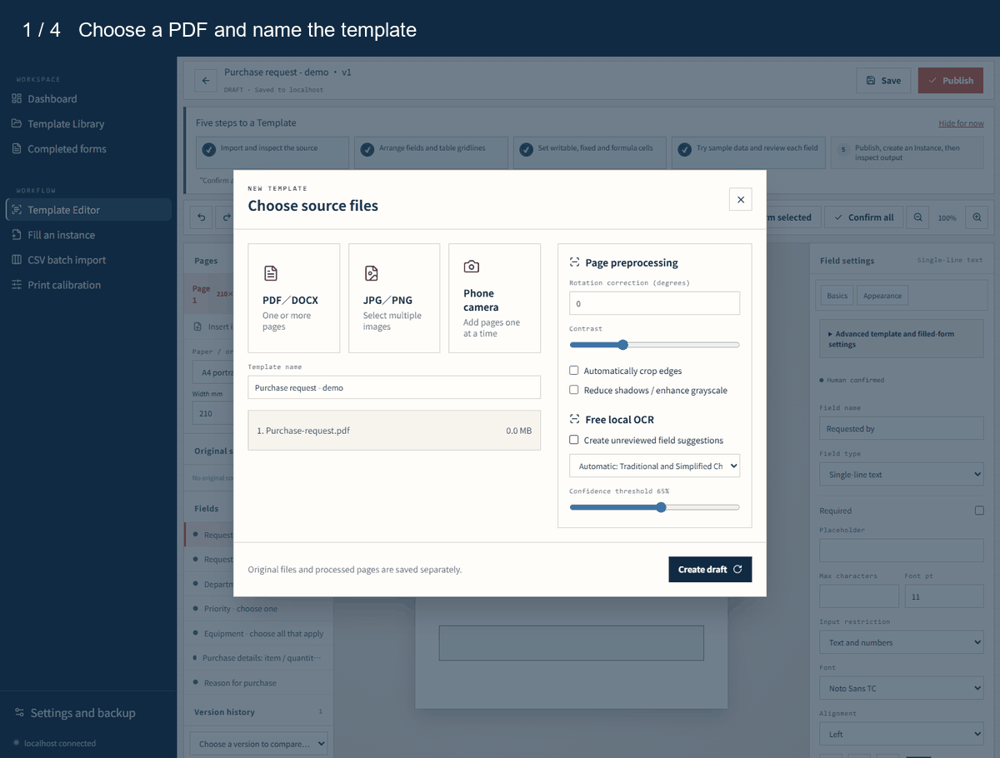
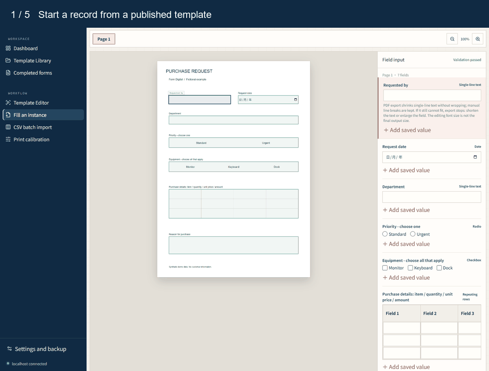
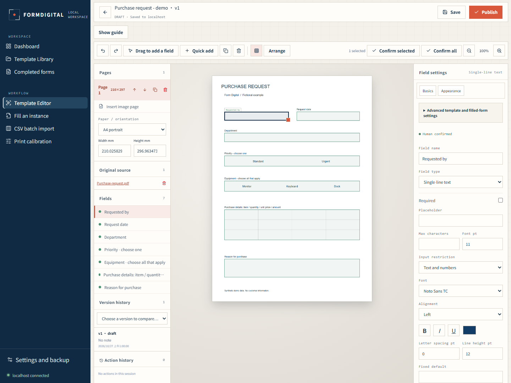
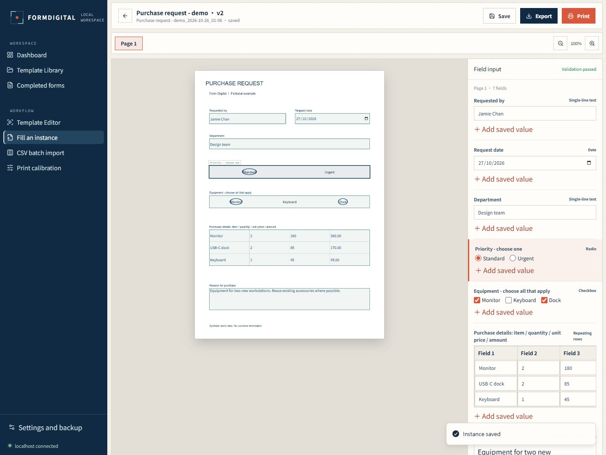
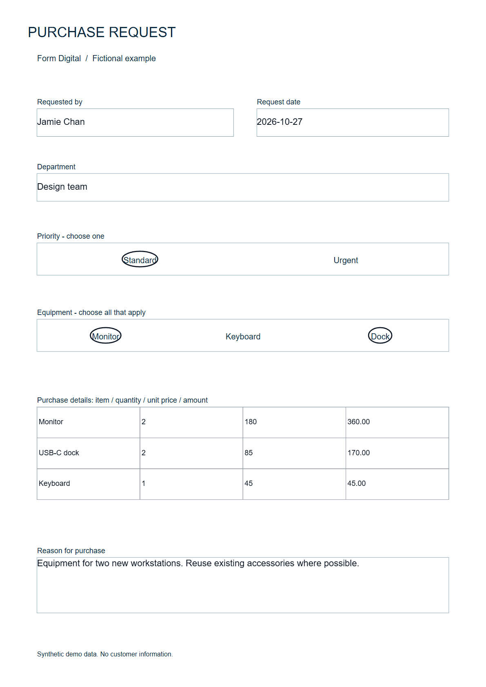
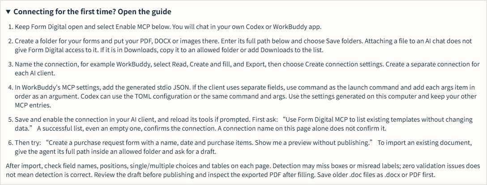

# Form Digital

[繁體中文](README.zh-Hant.md) · [简体中文](README.zh-Hans.md) · English

Form Digital is a local Windows app for turning paper forms and PDF or Office documents into reusable digital templates. You can import a PDF, DOCX or image, review suggested fields, fill separate records and export PDFs. It also supports offline OCR, choice marks, tables, formulas and print alignment.

The local edition runs on your computer through `localhost`. It needs no Google sign-in and does not upload your forms to a hosted Form Digital service. OCR suggestions still need a person to check field names and positions, especially for scanned or complex forms.

## See it in action

These captures use a fictional purchase request in the Windows release. The GIFs show selected steps from real app use, with waiting time omitted. Screenshots use the English interface; Traditional and Simplified Chinese are also available.

**Import a PDF and place a field**

**Fill a record and export the original form with answers**

View four screenshots and the sample PDF

**Template editor:** position fields over the source document and adjust their settings.

**Choices and formulas:** circle a single priority and multiple equipment choices. Quantity × unit price calculates each line amount.

**PDF output:** this is a rendering of the exported file. [Open the sample PDF](docs/media/sample-purchase-request.pdf).

**MCP guide:** connect your own compatible AI client, then chat there to create a draft, fill data or export. [Read the connection guide](docs/MCP.md).

[How these demos were captured](docs/media/README.md)

## Try the local edition

Download the Windows edition from [GitHub Releases](https://github.com/rickuuyu-create/formdigital/releases/latest). New users should choose the full **FormDigital-Windows-x64-*.zip**, extract the entire folder, and double-click `Form Digital.exe`. Node.js, OCR and the document conversion engine are included. Existing users should choose **FormDigital-Update-*.exe**, save their work and close Form Digital before updating their current program folder.

Use the release assets, rather than GitHub's automatically generated source archives, to run the app. Both downloads include the same application features.

To build a package from source yourself:

1. On Windows 10 or 11, install Node.js 24 and pnpm 10.4.1. The package builder also uses the Windows .NET Framework C# compiler. An internet connection is needed to install build dependencies; the resulting app runs locally.
2. From the repository folder, run `pnpm install --frozen-lockfile`, then `pnpm exec playwright install chromium` for the bundled document converter.
3. In PowerShell, run `./delivery/windows/build-package.ps1 -Destination "C:\Form Digital package"`. Choose a new destination outside this repository.
4. Copy the entire package folder to the Windows computer and double-click `Form Digital.exe`. Keep the launcher window open while using the site.

The launcher opens `http://localhost:3210/`. On first use, the guide points to **Start a new practice**, an eight-page example for learning the template editor before importing your own form. Change the interface language in **Settings & Backup**: Traditional Chinese, Simplified Chinese and English are available.

Your data is stored under `%LOCALAPPDATA%\FormDigital\Data` by default. It is outside the program folder, so replacing the program does not replace your forms. Back it up regularly in **Settings & Backup**. See [the Windows quick guide](delivery/windows/首次使用說明.txt) for everyday use.

Already have a Windows package? See [offline updates](delivery/windows/UPDATES.md) for the standalone updater and [recent changes](CHANGELOG.md) for the PDF layout fixes. Updates are checked against the package they were built for; an incompatible package is left unchanged.

## Optional MCP tools

The local edition can connect to Codex, WorkBuddy or another compatible local MCP client. Enable **AI connections (MCP)** in Settings & Backup, choose allowed folders and permissions, then copy the generated client configuration. The tools support template creation and import, filling, batch CSV, PDF output and data maintenance. MCP starts off and does not require Google sign-in. See [connection instructions, capabilities and tested limits](docs/MCP.md).

## Development

The normal development server retains an optional Google authentication path for testing. The packaged local edition enables `FORMDIGITAL_LOCAL_ONLY=1` and builds the interface with `VITE_FORMDIGITAL_LOCAL_ONLY=1`; no Google credentials are needed for the package. Keep secrets in local environment files, never in a public commit.

Run `pnpm check` for TypeScript, `pnpm test` for unit tests and `pnpm build` for a source build. Browser tests use isolated synthetic data. The bundled OCR runtime and language models have their own license notices in [`client/public/ocr-runtime`](client/public/ocr-runtime/README.md).

## License

Form Digital source code is licensed under [Apache License 2.0](LICENSE). Bundled third-party components retain their own licenses.

See [CONTRIBUTING.md](CONTRIBUTING.md) to report issues or submit changes using synthetic sample files.
